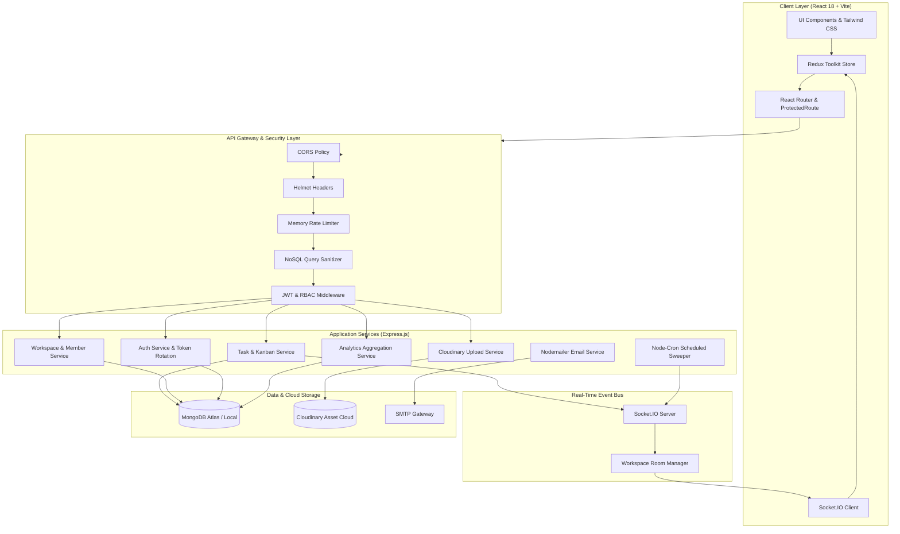
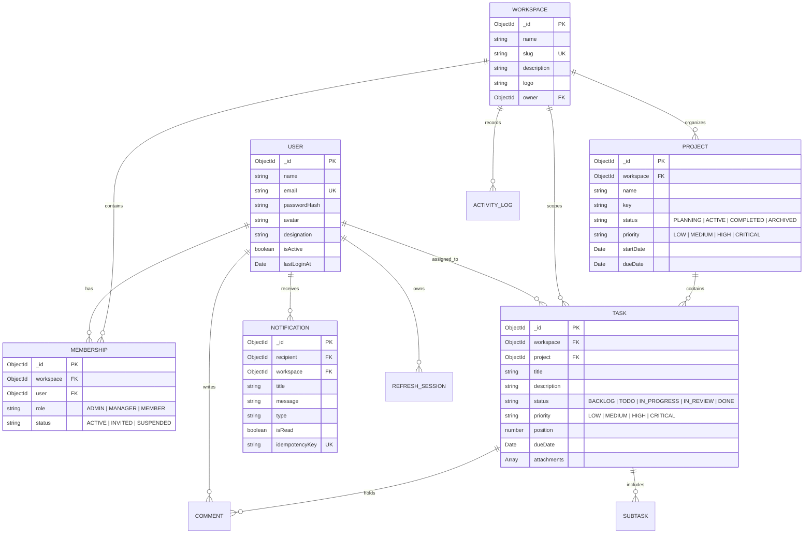

# TeamFlow – Enterprise B2B SaaS Project Management Platform

<p align="center">
  
</p>

<p align="center">
  <strong>Plan clearly. Work together. Deliver better.</strong>
</p>

<p align="center">
  <a href="#-technology-stack"></a>
  <a href="#-testing-instructions"></a>
  <a href="#-architecture-diagram"></a>
  <a href="#-api-documentation"></a>
  <a href="#-license"></a>
</p>

---

## 1. Project Overview

**TeamFlow** is a production-grade, full-stack B2B SaaS project management platform architected for modern cross-functional product and engineering teams. Designed with high attention to performance, real-time collaboration, and strict multi-tenant isolation, TeamFlow unifies task coordination, dynamic Kanban pipelines, interactive sprint calendars, real-time notification dispatch, and MongoDB aggregation analytics into a cohesive, elegant user experience.

---

## 2. Problem Statement

Modern product engineering teams frequently face fragmentation across disjointed productivity tools:
- **Data Sprawl & Loss of Context:** Teams juggle standalone task trackers, separate calendar tools, file repositories, and external messaging apps, resulting in lost requirements, stale sprint states, and coordination overhead.
- **Inadequate Multi-Tenant Boundaries:** Many SMB project tools lack enterprise-grade role-based access control (RBAC), leaving sensitive project documentation vulnerable to lateral team snooping.
- **Sluggish Real-Time Collaboration:** Traditional web applications require manual page reloads or aggressive client polling to capture teammate updates, leading to race conditions and merge conflicts during active sprint planning.

**TeamFlow** resolves this by providing a unified, multi-tenant collaboration engine with sub-second WebSocket synchronization, atomic optimistic UI mutations, and zero-trust workspace data segregation.

---

## 3. Main Features

- 🏢 **Multi-Workspace Organization & Tenancy:**
  - Create and manage isolated workspaces with dedicated URL slugs, logos, and organizational scopes.
  - Multi-tenant data segregation with user-to-workspace membership binding.
- 🛡️ **Role-Based Access Control (RBAC):**
  - Granular privilege enforcement across `ADMIN`, `MANAGER`, and `MEMBER` roles.
  - Cryptographically secure JWT tokens with HttpOnly refresh token rotation and automated reuse attack detection.
- 📋 **Interactive Kanban Board & Drag-and-Drop:**
  - Smooth task movement across columns (`Backlog`, `To Do`, `In Progress`, `In Review`, `Done`).
  - Lexicographical / fractional reordering (`@hello-pangea/dnd`) with optimistic state updates.
- ⚡ **Real-Time Collaboration Engine:**
  - Full-duplex WebSocket architecture powered by Socket.IO.
  - Live broadcast of task creations, status updates, column moves, comments, and subtask completions.
- 🔔 **Intelligent Notifications & Automated Sweeper:**
  - In-app notification center with instant unread badge counter and idempotent duplicate protection.
  - Automated `node-cron` background sweeper dispatching hourly alerts for approaching deadlines and overdue tasks.
- 📅 **Dynamic Multi-View Sprint Calendar:**
  - Month, Week, and Day calendar views calculating task deadlines and project milestone markers.
  - Click-to-open task inspection with project and priority filters.
- 📊 **Analytics & Velocity Dashboard:**
  - Native MongoDB aggregation pipelines calculating real completion rates, task status distributions, weekly velocity, and member workload productivity.
  - Interactive Recharts visualization with CSV report export.
- 📁 **Cloud Asset Management & File Attachments:**
  - Multi-format file attachments (PNG, JPG, PDF, DOCX, CSV up to 10MB) backed by Cloudinary streaming and resilient local fallback.
  - Profile avatar and workspace branding logo upload workflows.
- 📧 **Branded Transactional Email Integration:**
  - Nodemailer service with responsive HTML templates styled in TeamFlow's visual identity (Welcome, Workspace Invitation, Password Reset, Task Assignment, Deadline Reminder, Milestone Notification).

---

## 4. Technology Stack

### Frontend Architecture
- **Framework:** React 18 with Vite 5 (Fast Refresh, optimized Rollup bundling)
- **State Management:** Redux Toolkit (feature-sliced architecture, async thunks, optimistic reducers)
- **Routing:** React Router v6 (declarative protected route guards and splat fallbacks)
- **Styling & UI:** Tailwind CSS, Lucide React icons, custom design tokens
- **Drag & Drop:** `@hello-pangea/dnd`
- **Data Visualization:** Recharts
- **Testing:** Vitest, React Testing Library, JSDOM

### Backend Architecture
- **Runtime:** Node.js (ES Modules)
- **Framework:** Express.js (Layered Service-Repository Architecture)
- **Database:** MongoDB 7.0 via Mongoose ODM (Compound indexes, sparse indexes, aggregation pipelines)
- **Real-Time Layer:** Socket.IO 4.8 (Workspace room isolation, authenticated socket channels)
- **Security & Hardening:** Helmet (CORP configured), CORS origin checking, custom in-memory sliding-window Rate Limiter, NoSQL query sanitizer, bcryptjs password hashing
- **File Storage:** Multer memory storage + Cloudinary API streaming + local disk fallback
- **Email:** Nodemailer (SMTP transport with non-blocking async execution)
- **Job Scheduling:** Node-cron (distributed idempotency tracking)
- **API Documentation:** OpenAPI 3.0 via Swagger-UI-Express and Swagger-JSDoc
- **Testing:** Vitest, Supertest

---

## 5. Architecture Diagram



---

## 6. Application UI & Screens

| View | Description | Key Capabilities |
|---|---|---|
| **Kanban Board** | Visual drag-and-drop workflow | Move tasks across 5 status columns, task priority badges, assignee avatars, subtask checklists, and realtime peer synchronization. |
| **Task Details Modal** | Deep inspection drawer | Edit status, priority, due date; manage subtasks, comment thread, uploaded file attachments, and activity history. |
| **Calendar View** | Multi-view deadline tracking | Month, Week, and Day views rendering project milestones and task completion targets with filter toggles. |
| **Analytics Dashboard** | Executive reporting center | Project progress donuts, priority distribution charts, weekly completion velocity, and member workload productivity table. |
| **Workspace Settings** | Org & brand management | Workspace slug, mission statement, brand logo upload, user avatar management, and security policies. |

---

## 7. Folder Structure

```text
TeamFlow/
├── client/                               # Vite + React Frontend Application
│   ├── public/                           # Static assets, branding icons, and web manifest
│   ├── src/
│   │   ├── assets/                       # SVG logos, branding artwork
│   │   ├── components/
│   │   │   ├── common/                   # Global components (NotificationDropdown, Header, etc.)
│   │   │   ├── kanban/                   # KanbanBoard, KanbanColumn, TaskCard, TaskDetailsModal
│   │   │   ├── layout/                   # DashboardLayout, AuthLayout, Sidebar, Navbar
│   │   │   └── ui/                       # Primitive UI library (Button, Modal, Input, Badge, etc.)
│   │   ├── pages/                        # Screen views (Dashboard, Projects, Tasks, Kanban, etc.)
│   │   ├── routes/                       # ProtectedRoute and app route switchers
│   │   ├── services/                     # Axios instance and Socket.IO client
│   │   ├── store/                        # Redux slices (auth, workspace, project, task, analytics, etc.)
│   │   └── test/                         # Frontend Vitest & React Testing Library test suites
│   ├── index.html                        # SPA HTML root template
│   ├── tailwind.config.js                # Custom design system palette & typography
│   ├── vercel.json                       # Vercel SPA routing configuration
│   └── vite.config.js                    # Vite bundler & test configuration
├── server/                               # Express + Node.js API Server
│   ├── src/
│   │   ├── config/                       # Environment validator, MongoDB connection, Swagger spec
│   │   ├── controllers/                  # Route controller handlers
│   │   ├── middleware/                   # JWT auth, RBAC, Rate limiter, NoSQL sanitizer, Multer upload
│   │   ├── models/                       # Mongoose schemas (User, Workspace, Task, Project, etc.)
│   │   ├── routes/                       # Express routes (auth, workspaces, tasks, notifications, upload)
│   │   ├── services/                     # Core business logic, Cloudinary service, Email service, Cron
│   │   ├── sockets/                      # Real-time Socket.IO room and event handlers
│   │   ├── utils/                        # Async wrapper, token generator, password hashing
│   │   ├── app.js                        # Express application configuration
│   │   └── server.js                     # HTTP server startup, Socket.IO binding, database connection
│   ├── tests/                            # Backend Vitest & Supertest integration test suites
│   └── uploads/                          # Local disk storage fallback for uploads (.gitkeep preserved)
├── docs/                                 # Stage requirements and testing prompt specifications
├── .env.example                          # Consolidated environment configuration reference
├── .gitignore                            # Comprehensive git exclusion rules
├── render.yaml                           # Render cloud deployment blueprint
├── vercel.json                           # Vercel deployment configuration
├── package.json                          # Workspace root monorepo scripts
└── README.md                             # Project documentation
```

---

## 8. Database Schema Overview



---

## 9. API Documentation & OpenAPI Specification

TeamFlow exposes an interactive Swagger documentation portal at `/api/docs`.

### Core Endpoint Summary

| Module | Method | Endpoint | Access | Description |
|---|---|---|---|---|
| **Health** | `GET` | `/api/health` | Public | Server uptime, status, and DB readiness check |
| **Auth** | `POST` | `/api/auth/register` | Public | Account creation with automatic workspace seeding |
| **Auth** | `POST` | `/api/auth/login` | Public | Login credentials validation & HttpOnly cookie issuance |
| **Auth** | `POST` | `/api/auth/refresh` | Public | Token rotation with compromise reuse detection |
| **Auth** | `POST` | `/api/auth/logout` | Protected | Session revocation and cookie clearing |
| **Workspaces**| `GET` | `/api/workspaces` | Protected | Retrieve workspaces user belongs to |
| **Workspaces**| `POST`| `/api/workspaces` | Protected | Create new organization workspace |
| **Members** | `POST` | `/api/workspaces/:id/invitations` | Protected (ADMIN) | Invite collaborator via email token |
| **Projects** | `POST` | `/api/workspaces/:id/projects` | Protected (MANAGER) | Create project with timeline & budget |
| **Tasks** | `POST` | `/api/workspaces/:id/projects/:pId/tasks` | Protected (MEMBER) | Create task with assignees & metadata |
| **Kanban** | `PATCH`| `/api/workspaces/:id/tasks/:tId/move` | Protected (MEMBER) | Move task column and update position |
| **Analytics** | `GET` | `/api/workspaces/:id/analytics` | Protected (MEMBER) | MongoDB aggregation analytics metrics |
| **Calendar** | `GET` | `/api/workspaces/:id/calendar` | Protected (MEMBER) | Query deadlines within custom date range |
| **Uploads** | `POST` | `/api/upload` | Protected | Upload generic document or image |
| **Uploads** | `POST` | `/api/upload/avatar` | Protected | Upload profile photo to Cloudinary |
| **Uploads** | `POST` | `/api/upload/workspace/:id/logo` | Protected (ADMIN) | Upload workspace branding logo |

---

## 10. Installation Instructions

### Prerequisites
- **Node.js**: v18.x or v20.x LTS installed
- **MongoDB**: Local MongoDB instance running on `mongodb://127.0.0.1:27017` or a MongoDB Atlas connection string.
- **Git**

### Clone Repository
```bash
git clone https://github.com/TanishkaGupta2609/TeamFlow.git
cd TeamFlow
```

### Install Dependencies
Install all root, client, and server dependencies using npm workspaces:
```bash
npm install
```

---

## 11. Environment Variables Configuration

Copy `.env.example` to `server/.env` and `client/.env`:

### 1. Server Environment (`server/.env`)
```bash
cp server/.env.example server/.env
```
Populate values:
```env
PORT=5000
NODE_ENV=development
MONGODB_URI=mongodb://127.0.0.1:27017/teamflow
CLIENT_URL=http://localhost:5173
JWT_ACCESS_SECRET=your_32_character_jwt_access_secret_key_here
JWT_REFRESH_SECRET=your_32_character_jwt_refresh_secret_key_here
CLOUDINARY_CLOUD_NAME=your_cloud_name
CLOUDINARY_API_KEY=your_api_key
CLOUDINARY_API_SECRET=your_api_secret
SMTP_HOST=smtp.mailtrap.io
SMTP_PORT=2525
SMTP_USER=your_smtp_user
SMTP_PASSWORD=your_smtp_password
```

### 2. Client Environment (`client/.env`)
```bash
cp client/.env.example client/.env
```
Populate values:
```env
VITE_API_URL=http://localhost:5000/api
VITE_SOCKET_URL=http://localhost:5000
```

---

## 12. Local Development Instructions

Start both Backend and Frontend concurrently from the root directory:
```bash
npm run dev
```

Or start individual services independently:
```bash
# Terminal 1: Backend Server (starts on http://localhost:5000)
npm run dev:server

# Terminal 2: Frontend Client (starts on http://localhost:5173)
npm run dev:client
```

Open your browser at `http://localhost:5173` to explore TeamFlow.

---

## 13. Testing Instructions

TeamFlow includes **193 automated tests** covering backend database models, security middlewares, multi-tenant RBAC boundaries, token rotation, frontend component units, and end-to-end form validations.

```bash
# Run all automated tests across monorepo
npm test

# Run backend test suite (9 test files, 128 tests)
npm run test:server

# Run frontend test suite (7 test files, 65 tests)
npm run test:client

# Verify production frontend bundle build
npm run build --workspace=client
```

---

## 14. Deployment Instructions

### Production Deployment: Frontend on Vercel
1. Link your GitHub repository to [Vercel](https://vercel.com).
2. Set Root Directory to `./` (or `client`).
3. Set Framework to `Vite`.
4. Build Command: `npm run build --workspace=client`
5. Output Directory: `client/dist`
6. Add Environment Variables:
   - `VITE_API_URL`: `https://<your-render-backend-url>/api`
   - `VITE_SOCKET_URL`: `https://<your-render-backend-url>`
7. The included `vercel.json` provides single-page application (SPA) rewrite rules to ensure seamless client-side routing on page refreshes.

### Production Deployment: Backend on Render
1. Create a new Web Service on [Render](https://render.com) connected to your repository.
2. Build Command: `npm install`
3. Start Command: `npm run start:server`
4. Set Environment Variables:
   - `NODE_ENV`: `production`
   - `PORT`: `10000`
   - `MONGODB_URI`: `<Your MongoDB Atlas Connection String>`
   - `CLIENT_URL`: `https://<your-vercel-frontend-url>`
   - `JWT_ACCESS_SECRET`: `<Secure random 64-character secret>`
   - `JWT_REFRESH_SECRET`: `<Secure random 64-character secret>`
   - Cloudinary & SMTP credentials.
5. The included `render.yaml` can be used to deploy the service via Render Blueprints automatically.

### Production Deployment: Database on MongoDB Atlas
1. Create a MongoDB Atlas M0 (Free Tier) or Dedicated Cluster.
2. Add a Database User with read/write permissions.
3. Configure Network Access to allow Render application IPs (or `0.0.0.0/0` with secure credentials).
4. Obtain the connection string `mongodb+srv://<user>:<password>@cluster.mongodb.net/teamflow` and assign it to `MONGODB_URI`.

---

## 15. Future Improvements

- 🤖 **AI-Assisted Sprint Planning:** Automated task duration estimation and smart task breakdown using Google Gemini 1.5 API.
- 📱 **Mobile Native Experience:** React Native companion application for iOS and Android.
- 🔗 **Third-Party Integrations:** Two-way synchronization with GitHub PRs, Slack notifications, and Jira issue importing.
- ⚡ **Redis Distributed Cache:** Caching layer for high-volume analytics queries and Redis pub/sub adapter for multi-instance Socket.IO clustering.

---

## 16. License

This project is licensed under the **MIT License** — see the [LICENSE](LICENSE) file for details.
